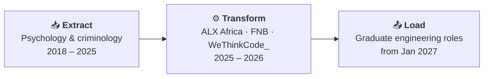

<!-- Profile README for github.com/Sanieeme (lives in the repo named exactly: Sanieeme) -->

 

---

## 👋 A little about me

I'm **Shonisani**, a software engineering student at **WeThinkCode\_** (class of December 2026) who came to code through **psychology and criminology**. I finished the **ALX Africa** backend software engineering specialisation in 2025, and I build database-driven web apps, REST APIs and data pipelines in Python and Java.

Studying people taught me to research before I build, and to ask *why* before *how*.

> [!TIP]
> **Available from January 2027** for a first engineering role, on-site in Gauteng, South Africa.

## 🧭 My path, told like a pipeline

## 🌱 What I'm up to

- 🔭 Going deeper into **backend development**: APIs, databases and the logic between them
- 💻 Writing code in **Python, Java, C and JavaScript**
- 🤝 **Open to collaborating** on beginner-friendly backend or Python projects, and on data pipelines, education tech and open source
- 🧪 Practising with **Flask, SQLAlchemy, Pandas and Docker** in my own projects
- ⚡ Fun fact: nothing comes easy (and I'm still here anyway)

## 🛠️ Tech I use

**Languages**

**Backend, data & databases**

**Tools & platforms**

## 📌 Projects

| Project | What it is | Links |
| :-- | :-- | :-- |
| **Quizeers** | A full-stack learning platform on Flask and SQLAlchemy with role-based authentication, timed quizzes, progress tracking and JSON/CSV quiz import. Containerised with Docker Compose, with GitHub Actions running builds and tests. | [Live demo](https://sanieeme.github.io/quizeers/) · [Source](https://github.com/Sanieeme/quizeers) |
| **Crypto & weather pipeline** | An ETL pipeline that extracts structured datasets, cleans and transforms them with Pandas, and prepares them for analysis. | [Source](https://github.com/Sanieeme/crypto_weather_pipeline) |
| **SkiLinkr v2** | A team project built with other developers towards shared requirements, using Git and agile practices. | [Source](https://github.com/Sanieeme/SkiLinkr_v2) |
| **Portfolio site** | My personal site, with a live Rorschach-style inkblot, an API request tracer and a light/dark theme. | [Visit](https://sanieeme.github.io/profile/) · [Source](https://github.com/Sanieeme/profile) |

More are on the way as I learn.

## 📈 GitHub stats

  
  

  

## 🤝 Let's collaborate

Got an idea, a project that needs a backend or a data pipeline, or a team that could use another pair of hands? Tell me about it:

**[→ Send a collaboration idea](https://sanieeme.github.io/profile/#collab)** or email me at [shoneesani@gmail.com](mailto:shoneesani@gmail.com).

---

*Pronouns: bestie* 💖

